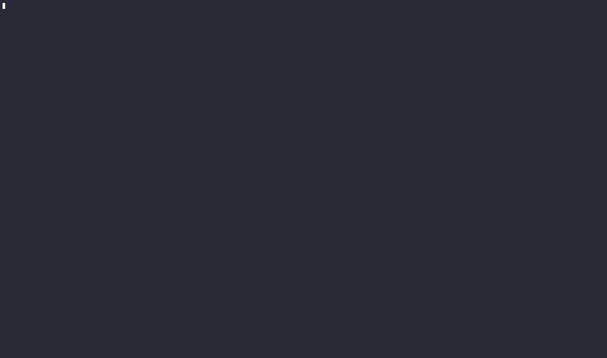

# AsciiArtify: minikube, kind і k3d для локальної розробки

## Вступ

minikube, kind і k3d створюють локальні Kubernetes-кластери для розробки, тестування та CI. Продакшн-середовище в документі не розглядається.

- **minikube** — офіційний інструмент Kubernetes SIG; кластер у VM або контейнері.
- **kind** (Kubernetes IN Docker) — офіційний інструмент Kubernetes SIG; вузли kubeadm-кластера в контейнерах, основне призначення — тестування Kubernetes і CI.
- **k3d** — запуск k3s (легкого дистрибутиву Kubernetes від Rancher) у контейнерах.

## Характеристики

| Критерій | minikube | kind | k3d |
| --- | --- | --- | --- |
| Підтримка | Kubernetes SIG | Kubernetes SIG | Rancher / SUSE |
| Дистрибутив | upstream (kubeadm) | upstream (kubeadm) | k3s |
| Вузли | VM або контейнер | Docker-контейнер | Docker-контейнер |
| Драйвери | VirtualBox, Hyper-V, HyperKit, QEMU, KVM, Docker, Podman | Docker, Podman (experimental) | Docker, Podman (experimental) |
| ОС | Linux, macOS, Windows | Linux, macOS, Windows | Linux, macOS, Windows |
| Архітектури | amd64, arm64 | amd64, arm64 | amd64, arm64 |
| Мультинода | обмежено | YAML-конфіг | `--agents N` |
| LoadBalancer | `minikube tunnel` | немає з коробки | вбудований (ServiceLB + nginx proxy) |
| Ingress | addon | встановлюється окремо | Traefik |
| Registry | addon | `kind load docker-image` | `--registry-create` |
| Dashboard / метрики | addons | встановлюються окремо | встановлюються окремо |
| Конфіг кластера | CLI-прапорці, профілі | YAML | YAML |
| CI | обмежено | GitHub Action | GitHub Action |
| Пам'ять, MiB | 602 | 770 | 671 (645 вузол + 26 LB) |
| Час до Ready, с | 49.7 | 30.6 | 15.9 |
| Системні поди з коробки | 8: control-plane, CoreDNS, kindnet, storage-provisioner | 9: control-plane, 2× CoreDNS, kindnet, local-path | 5 + 2 Jobs: CoreDNS, local-path, metrics-server, Traefik, svclb; control-plane в одному процесі k3s |
| Перевірена версія | minikube v1.39.0, Kubernetes v1.37.0 | kind v0.33.0, Kubernetes v1.37.0 | k3d v5.9.0, k3s v1.35.5 |

Заміри: Linux Mint 22.3, Docker, один вузол, образи в кеші. Час — від запуску CLI до `kubectl wait --for=condition=Ready nodes`; пам'ять — `docker stats` через 60 с після готовності.

### Ліцензування Docker і Podman

Docker Desktop потребує платної підписки для організацій з понад 250 працівниками або понад $10 млн річного доходу. Docker Engine, CLI і Compose розповсюджуються під Apache 2.0 і безкоштовні ([Docker FAQ](https://docker.io/pricing/faq/)). Для AsciiArtify ризик виникає при перевищенні порогу; на Linux його знімає використання Docker Engine замість Desktop.

Podman — daemonless рушій контейнерів від Red Hat з підтримкою rootless і Docker-сумісним API. Сам рушій стабільний; експериментальною є його інтеграція з інструментами:

| Інструмент | Підтримка Podman | Обмеження |
| --- | --- | --- |
| minikube | драйвер `podman`, experimental | — |
| kind | `KIND_EXPERIMENTAL_PROVIDER=podman`, experimental | rootless потребує cgroup v2 |
| k3d | Podman v4+ через Docker API-сокет, experimental ([k3d docs](https://k3d.io/v5.4.1/usage/advanced/podman/)) | мережа `podman` без DNS: для мультиноди потрібна окрема мережа |

На macOS і Windows Podman працює через `podman machine` (VM).

## Переваги та недоліки

| Інструмент | Переваги | Недоліки |
| --- | --- | --- |
| minikube | Найменша пам'ять у базовій конфігурації (602 MiB); найширший набір addons; вбудований dashboard; VM-драйвери; повна документація | Найдовший старт (49.7 с); з VM-драйвером вищі вимоги до ресурсів; слабка мультинода; обмежено придатний для CI |
| kind | Upstream Kubernetes; вибір версії через образ вузла; мультинода й HA control-plane; стандарт для CI | Найбільша пам'ять (770 MiB); немає LoadBalancer, ingress, registry з коробки; образи завантажуються вручну |
| k3d | Найшвидший старт (15.9 с); пам'ять на рівні інших попри додаткові компоненти; LoadBalancer, ingress, registry з коробки; мультинода однією командою | k3s замість upstream (SQLite/etcd, Traefik, ServiceLB); менша спільнота; не проєкт SIG |

## Демонстрація

Розгортання Hello World у k3d: кластер з двома агентами, ingress через вбудований Traefik і LoadBalancer.

```bash
k3d cluster create asciiartify --agents 2 -p "8080:80@loadbalancer"
kubectl get nodes
kubectl create deployment hello --image=nginxdemos/hello:plain-text
kubectl rollout status deployment/hello
kubectl expose deployment hello --port=80
kubectl create ingress hello --rule="/*=hello:80"
curl localhost:8080
k3d cluster delete asciiartify
```



## Висновки

| Інструмент | Застосування |
| --- | --- |
| k3d | основне середовище PoC |
| kind | інтеграційні тести в CI (GitHub Actions) |
| minikube | резерв: VM-драйвер, addons, Windows без Docker |

### Перенесення в хмару

Усі три інструменти дають CNCF-conformant Kubernetes: маніфести, Helm-чарти та образи переносяться в керований кластер без змін. Відрізняються компоненти середовища:

| Компонент | Локально | Керований кластер (GKE, EKS, AKS) |
| --- | --- | --- |
| LoadBalancer | емуляція інструментом | cloud provider |
| Ingress | Traefik (k3d) або встановлений вручну | контролер провайдера або власний |
| StorageClass | `local-path` / `standard` | диски провайдера |
| Registry | локальний | Artifact Registry, ECR, ACR |

Залежні від середовища параметри виносяться у values Helm-чарту; специфічні фічі інструменту в маніфестах не використовуються.
