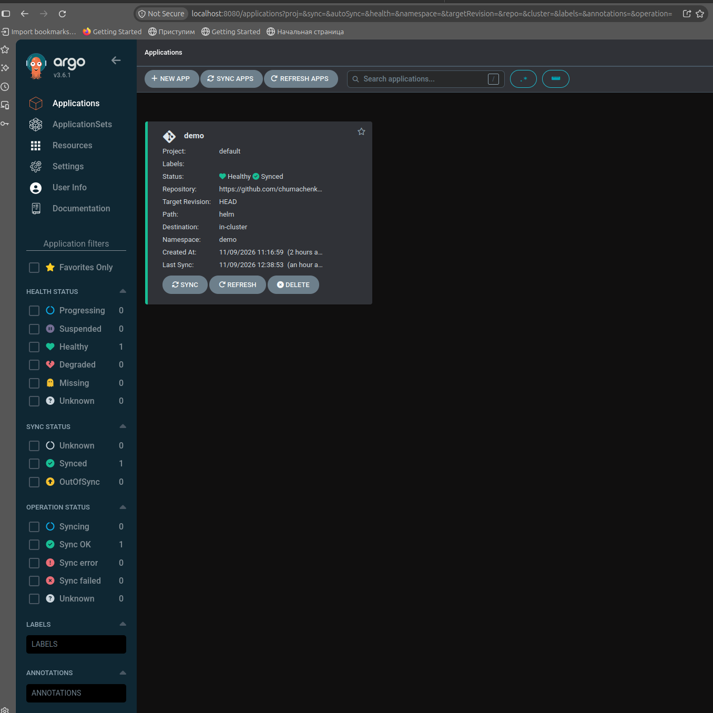

# AsciiArtify: PoC

Розгортання GitOps-системи ArgoCD у локальному кластері k3d, обраному на етапі [Concept](Concept.md). Результат — встановлений ArgoCD з доступом до графічного інтерфейсу, готовий до реалізації [MVP](MVP.md).

## Середовище

| Компонент | Значення |
| --- | --- |
| Кластер | k3d v5.9.0, k3s v1.35.5 |
| ArgoCD | маніфест `stable`, неймспейс `argocd` |
| Доступ до UI | `kubectl port-forward`, https://localhost:8080 |

## Розгортання

```bash
k3d cluster create argocd-poc
kubectl create namespace argocd
kubectl apply -n argocd --server-side --force-conflicts \
  -f https://raw.githubusercontent.com/argoproj/argo-cd/stable/manifests/install.yaml
kubectl -n argocd wait --for=condition=Ready pods --all --timeout=300s
kubectl -n argocd get pods
```

`--server-side` потрібен, оскільки частина CRD ArgoCD перевищує ліміт розміру анотації для client-side apply.

## Доступ до інтерфейсу

1. Отримати початковий пароль користувача `admin`:

   ```bash
   kubectl -n argocd get secret argocd-initial-admin-secret -o jsonpath="{.data.password}" | base64 -d; echo
   ```

2. Відкрити тунель до сервісу `argocd-server`:

   ```bash
   kubectl -n argocd port-forward svc/argocd-server 8080:443
   ```

3. Відкрити https://localhost:8080 і прийняти самопідписаний сертифікат.
4. Увійти з логіном `admin` і паролем з кроку 1.
5. Змінити пароль: **User Info → Update Password**. Після цього початковий секрет можна видалити:

   ```bash
   kubectl -n argocd delete secret argocd-initial-admin-secret
   ```

## Демо

Розгортання кластера, встановлення ArgoCD і перевірка доступності інтерфейсу:


Інтерфейс ArgoCD після входу:


